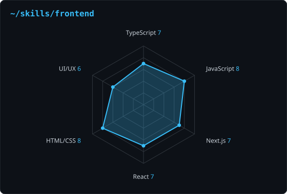
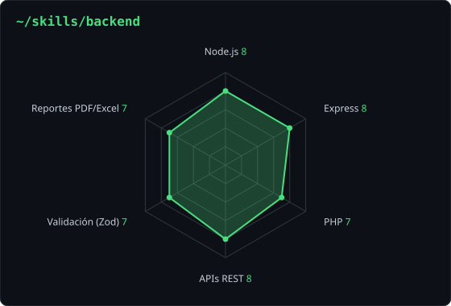
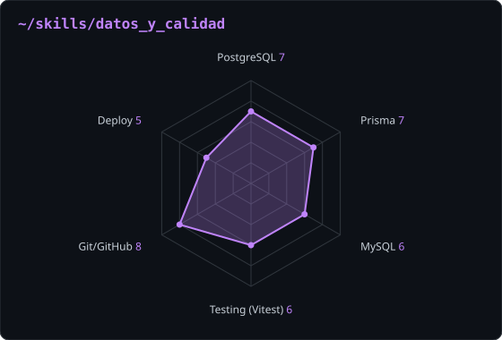

<h1 align="center">Hola, soy Carlos Galoc 👋</h1>

  <b>Full Stack Developer</b> · TypeScript · Next.js · Node.js · PostgreSQL 
  📍 Bagua, Perú

  
  

---

### 🧑‍💻 Sobre mí

Desarrollo aplicaciones web de punta a punta: interfaces con **Next.js**, APIs con **Node.js/Express** y **PHP**, y datos con **PostgreSQL + Prisma**. Me interesa el software útil para salud, educación y gestión, con código tipado, probado y bien documentado.

---

<table>
  <tr>
    <td colspan="2"><code><b>carlos@bagua:~$ cat tech-stack.yaml</b></code></td>
  </tr>
  <tr>
    <td width="50%" valign="top">
      <code>├─ ◆ frontend:</code>  
       
      <code>TypeScript · JavaScript · Next.js · React · HTML · CSS</code>
    </td>
    <td width="50%" valign="top">
      <code>├─ ▣ databases:</code>  
       
      <code>PostgreSQL · Prisma · MySQL · Neon</code>
    </td>
  </tr>
  <tr>
    <td valign="top">
      <code>├─ ⚙ backend:</code>  
       
      <code>Node.js · Express · PHP · Zod · APIs REST</code>
    </td>
    <td valign="top">
      <code>├─ ◉ hosting:</code>  
       
      <code>Vercel · Neon · GitHub</code>
    </td>
  </tr>
  <tr>
    <td valign="top">
      <code>├─ ✦ reportes:</code>  
      
        
      <code>pdfkit · exceljs</code>
    </td>
    <td valign="top">
      <code>└─ ~ quality_devops:</code>  
       
      <code>Git · Vitest · VS Code</code>
    </td>
  </tr>
  <tr>
    <td colspan="2" valign="top">
      <b>Asistentes y documentación</b>  
      
      
      
    </td>
  </tr>
  <tr>
    <td colspan="2"><code>status: en formación · environment: production</code></td>
  </tr>
</table>

---

### 📊 Autoevaluación de habilidades

  
  
  

Niveles autoasignados (0–10).

---

### 🚀 Proyectos destacados

| Proyecto | Descripción | Stack |
|---|---|---|
| [ManoaMano.Pe](https://github.com/PePiNo0204/ManoaMano.Pe) | _Descripción breve del proyecto._ | TypeScript |
| [ControlLaboratorio](https://github.com/PePiNo0204/ControlLaboratorio) | Gestión y control de un laboratorio. | TypeScript |
| [ControlDispositivosInteligentes](https://github.com/PePiNo0204/ControlDispositivosInteligentes) | Control de dispositivos inteligentes. | TypeScript |
| [clinica-sonrisas](https://github.com/PePiNo0204/clinica-sonrisas) | Sistema web para una clínica dental. | PHP |
| [OsTicket-Testeado](https://github.com/PePiNo0204/OsTicket-Testeado) | Pruebas sobre el sistema de tickets osTicket. | PHP |
| **Clínica pediátrica** _(equipo, privado)_ | Backend: pacientes, curvas de crecimiento OMS y reportes PDF/Excel. | Node.js · Prisma · PostgreSQL |

#### 🛠️ Próximamente (noviembre 2026)

- [ ] **Proyecto 1** — _en construcción_
- [ ] **Proyecto 2** — _en construcción_
- [ ] **Proyecto 3** — _en construcción_

---

<code>carlos@bagua:~$ echo "¡Gracias por visitar!"</code>

