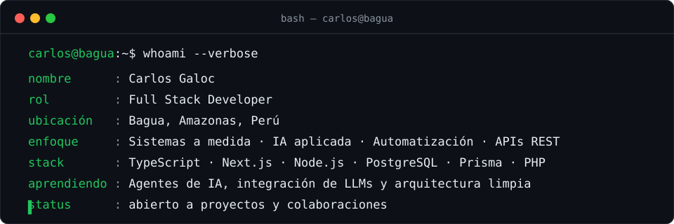
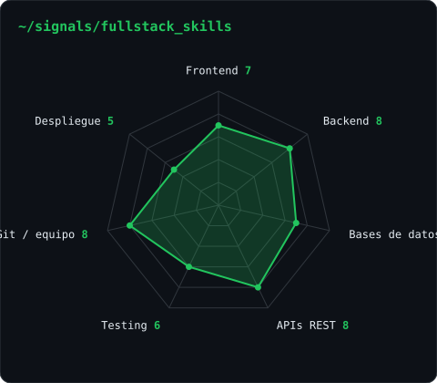
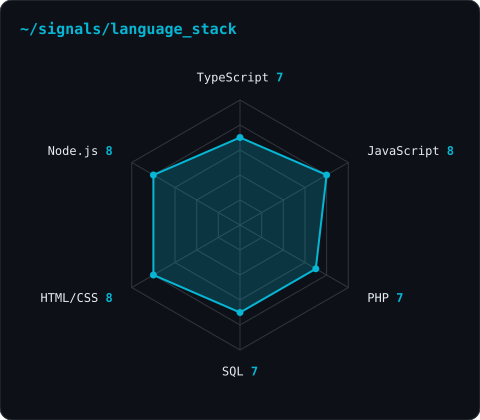

<div align="center">

<a href="https://github.com/PePiNo0204">
  
</a>

<br>


</div>

---

## `$ whoami`

<p align="center">
  <picture>
    <source media="(prefers-color-scheme: dark)" srcset="assets/whoami-dark.svg">
    <source media="(prefers-color-scheme: light)" srcset="assets/whoami-light.svg">
    
  </picture>
</p>

<div align="center">

## `$ cat tech-stack.yaml`

<table border="1" cellpadding="14">
<thead><tr><th colspan="2" align="left"><code>carlos@bagua:~$ cat tech-stack.yaml</code></th></tr></thead>
<tbody>
<tr>
<td width="50%" valign="top"><code>├─ ◆ frontend:</code><br><br><br><sub><code>TypeScript · JavaScript · Next.js · React · HTML · CSS</code></sub></td>
<td width="50%" valign="top"><code>├─ ▣ databases:</code><br><br><br><sub><code>PostgreSQL · Prisma · MySQL · Neon</code></sub></td>
</tr>
<tr>
<td valign="top"><code>├─ ⚙ backend:</code><br><br><br><sub><code>Node.js · Express · PHP · Zod · APIs REST</code></sub></td>
<td valign="top"><code>├─ ◉ reports_hosting:</code><br><br>  <br><sub><code>PDFKit · ExcelJS · Vercel · Neon</code></sub></td>
</tr>
<tr>
<td colspan="2" valign="top"><code>╰─ ⌁ quality_devops:</code><br><br><br><sub><code>Git · GitHub (ramas y PR) · Vitest · VS Code</code></sub></td>
</tr>
<tr>
<td colspan="2" valign="top"><b>Asistentes de IA y herramientas</b><br><br>       <br><sub><code>Claude · Claude Code · GitHub Copilot · ChatGPT · Gemini · Git · VS Code · Markdown</code></sub></td>
</tr>
</tbody><tfoot><tr><td colspan="2"><code>status: en formación · environment: production</code></td></tr></tfoot>
</table>

</div>

---

## `$ ./signals --skills`

<p align="center">
  <picture><source media="(prefers-color-scheme: dark)" srcset="assets/radar-fullstack-dark.svg"><source media="(prefers-color-scheme: light)" srcset="assets/radar-fullstack-light.svg"></picture>&nbsp;
  <picture><source media="(prefers-color-scheme: dark)" srcset="assets/radar-langs-dark.svg"><source media="(prefers-color-scheme: light)" srcset="assets/radar-langs-light.svg"></picture>
</p>

<p align="center"><sub>Autoevaluación orientativa (0–10), no son métricas oficiales de GitHub.</sub></p>

---

## `$ ls proyectos/`

| Proyecto | Qué construí | Tecnologías |
|:--|:--|:--|
| **Clínica pediátrica** _(equipo, privado)_ | Backend: pacientes, curvas de crecimiento OMS con alertas y reportes PDF/Excel. | Node.js · TypeScript · Express · Prisma · PostgreSQL · Neon · Zod · Vitest |
| [ManoaMano.Pe](https://github.com/PePiNo0204/ManoaMano.Pe) | _Descripción breve del proyecto._ | TypeScript |
| [ControlLaboratorio](https://github.com/PePiNo0204/ControlLaboratorio) | Gestión y control de un laboratorio. | TypeScript |
| [ControlDispositivosInteligentes](https://github.com/PePiNo0204/ControlDispositivosInteligentes) | Control de dispositivos inteligentes. | TypeScript |
| [Clínica Sonrisas](https://github.com/PePiNo0204/clinica-sonrisas) | Sistema web para una clínica dental. | PHP |
| [OsTicket-Testeado](https://github.com/PePiNo0204/OsTicket-Testeado) | Pruebas sobre el sistema de tickets osTicket. | PHP |

```text
$ git log --oneline --upcoming   # próximos proyectos (noviembre 2026)
[ ] proyecto-1  ·  en construcción
[ ] proyecto-2  ·  en construcción
[ ] proyecto-3  ·  en construcción
```

---

## `$ tail -f actividad.log`

<p align="center"></p>

---

## `$ connect --socials`

<div align="center">
<a href="https://www.linkedin.com/in/TU-USUARIO"></a>&nbsp;&nbsp;
<a href="https://TU-PORTAFOLIO.com"></a>&nbsp;&nbsp;
<a href="https://github.com/PePiNo0204"></a>
</div>

<br>
<div align="center"><sub>Hecho desde Bagua, Amazonas, Perú · @PePiNo0204</sub></div>
